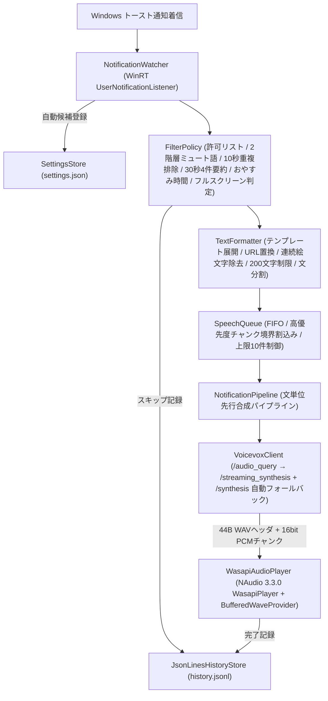

# NotifyVox 開発ウォークスルー

本ドキュメントは、NotifyVox の初期環境構築・API 疎通確認（フェーズ 0）から、ドメインロジック・Windows 連携・タスクトレイ常駐 UI・4タブ設定画面の本実装および実機結合検証（フェーズ 1〜3）までの全工程と検証結果をまとめたウォークスルーです。

---

## 目次

1. [全体の進捗と達成状況](#1-全体の進捗と達成状況)
2. [フェーズ 0: 環境構築・API 分析・MSIX loose-layout 基盤](#2-フェーズ-0-環境構築api-分析msix-loose-layout-基盤)
3. [フェーズ 1: コアパイプラインとストリーミング読み上げ実装](#3-フェーズ-1-コアパイプラインとストリーミング読み上げ実装)
4. [フェーズ 2: 4タブ設定 UI と再起動不要の即時反映](#4-フェーズ-2-4タブ設定-ui-と再起動不要の即時反映)
5. [フェーズ 3: 履歴・ホットキー・自動起動・プライバシー保護ログ](#5-フェーズ-3-履歴ホットキー自動起動プライバシー保護ログ)
6. [単体テストおよび実機 E2E 検証結果](#6-単体テストおよび実機-e2e-検証結果)

---

## 1. 全体の進捗と達成状況

[SPEC.md §10](../SPEC.md#10-開発フェーズマイルストーン) のマイルストーン（フェーズ 0〜3 の主要機能）の実装と実機疎通検証を完了しました。



---

## 2. フェーズ 0: 環境構築・API 分析・MSIX loose-layout 基盤

- **.NET 10 LTS & 4プロジェクト分離**:
  - `NotifyVox.Core` (`net10.0`): OS・UI 非依存の純粋ドメイン層。
  - `NotifyVox.Windows` (`net10.0-windows10.0.19041.0`): WinRT `UserNotificationListener`、NAudio WASAPI 再生、Win32 P/Invoke (`[LibraryImport]`)、WinRT `StartupTask`。
  - `NotifyVox.App` (`net10.0-windows10.0.19041.0`, WPF): `H.NotifyIcon.Wpf` トレイ常駐、`CommunityToolkit.Mvvm` 設定画面、Serilog、`Microsoft.Extensions.Hosting`。
  - `NotifyVox.Core.Tests` (`net10.0`): xUnit v3 + Microsoft.Testing.Platform + NSubstitute + `FakeTimeProvider`。
- **MSIX loose-layout 開発ループ**:
  - [packaging/AppxManifest.xml](../packaging/AppxManifest.xml) と [scripts/register-dev.ps1](../scripts/register-dev.ps1)（`-PreserveApplicationData` 対応）により、設定データを保持したまま高速にパッケージ再登録・実機確認が可能。

---

## 3. フェーズ 1: コアパイプラインとストリーミング読み上げ実装

- **[`TextFormatter`](../src/NotifyVox.Core/Formatting/TextFormatter.cs)**:
  - `{app}`, `{title}`, `{body}`, `{time}`（および日本語プレースホルダ）展開。
  - 空タイトル省略、タイトル＝本文時の重複省略、両方空時のスキップ。
  - URL の `URL` 読み替え、グラフェムクラスタ単位での連続絵文字除去（単一絵文字や `@` メンションは保持）、文字数上限切り詰め＋「以下省略」付与。
  - 疑問符 `？` 等を文末に維持した文分割（VOICEVOX の `enable_interrogative_upspeak` を活用）。
- **[`FilterPolicy`](../src/NotifyVox.Core/Filtering/FilterPolicy.cs)**:
  - アプリ許可リスト（既定 OFF）、全体＋アプリ別の 2 階層キーワードミュート。
  - 10 秒以内の同一通知重複排除（F9）。
  - 30 秒以内に同一アプリから 4 件以上着信した際の「○○から N 件の通知です」要約発話と 60 秒間の連投抑制モード（F10）。
  - 手動ミュート、日跨ぎ対応のおやすみ時間帯（F11）、フルスクリーン実行中ミュート（F12）。
- **[`SpeechQueue`](../src/NotifyVox.Core/Queueing/SpeechQueue.cs) & [`NotificationPipeline`](../src/NotifyVox.Core/Pipeline/NotificationPipeline.cs)**:
  - FIFO 順次再生、高優先度通知のチャンク境界割込み（F14）、上限 10 件超過時の最古通常通知破棄（F15）。
  - 現在の文を `WasapiAudioPlayer` で再生しながら、次の文の `audio_query` + `streaming_synthesis` を `BoundedChannel` へ先行フェッチする文間ゼロギャップ・パイプライン（F22-3）。
- **[`VoicevoxClient`](../src/NotifyVox.Core/Voicevox/VoicevoxClient.cs) & [`WasapiAudioPlayer`](../src/NotifyVox.Windows/Audio/WasapiAudioPlayer.cs)**:
  - `POST /streaming_synthesis`（非対応話者・エンジンでは `POST /synthesis` へ自動フォールバック）、1 文 10 秒タイムアウト、連続 5 回失敗時の既定話者フォールバック。
  - NAudio 3.3.0 `WasapiPlayerBuilder` (`BuildAsync`) + `BufferedWaveProvider` により、1 チャンク目到着と同時に再生開始。ブロック境界アライメントと 16bit PCM サンプル単位の音量スケーリングによりノイズのない再生を実現。

---

## 4. フェーズ 2: 4タブ設定 UI と再起動不要の即時反映

- **[`MainWindow.xaml`](../src/NotifyVox.App/MainWindow.xaml) / [`MainViewModel`](../src/NotifyVox.App/ViewModels/MainViewModel.cs)**:
  1. **アプリ一覧タブ**: アクションセンター既存通知および新規受信通知からアプリを自動候補収集。ON/OFF、個別話者、優先度、個別テンプレート、個別ミュートワードを設定可能。未許可時は Windows 通知設定への誘導バナーを表示。
  2. **読み上げタブ**: VOICEVOX 接続ステータス、話者・スタイル選択、話速・音高・抑揚・音量スライダー、WASAPI 出力デバイス選択、テンプレート・文字数上限・URL 読み替え設定。
  3. **ミュートタブ**: 手動ミュート、グローバルホットキー（`Ctrl+Alt+M` 既定）、おやすみ時間帯、フルスクリーン中ミュート、全体ミュートキーワード。
  4. **全般・履歴タブ**: Windows サインイン時自動起動、起動時未読通知読み上げ設定、VOICEVOX エンドポイント（非 localhost 指定時のセキュリティ警告付き）・自動起動パス、ログ/設定フォルダリンク、および直近 200 件のリアルタイム履歴テーブル。
- すべての設定変更は即座に `settings.json` へアトミック保存され、再起動なしで稼働中のパイプライン・ホットキーへ即時反映されます（F25）。

---

## 5. フェーズ 3: 履歴・ホットキー・自動起動・プライバシー保護ログ

- **[`JsonLinesHistoryStore`](../src/NotifyVox.Core/History/JsonLinesHistoryStore.cs)**: `history.jsonl` への追記保存と保持日数（既定 7 日）に基づく自動クリーンアップ。
- **[`GlobalHotkeyManager`](../src/NotifyVox.Windows/Interop/GlobalHotkeyManager.cs)**: `HWND_MESSAGE` メッセージ専用ウィンドウを用いた Win32 `RegisterHotKey` 常駐待ち受け。
- **[`StartupTaskService`](../src/NotifyVox.Windows/Startup/StartupTaskService.cs)**: MSIX `StartupTask` (`NotifyVoxStartup`) 連携。自動起動時はウィンドウを出さずにトレイへ静かに常駐。
- **プライバシー保護ログ**: Serilog `5MB × 3` 世代ローテーションに加え、`HttpClient` の URL クエリログを抑制し、通知本文がログファイルへ一切記録されないことを実機検証で確認済み（SPEC §5, §8）。

---

## 6. 単体テストおよび実機 E2E 検証結果

### 6.1 ビルド・単体テスト
```powershell
dotnet build NotifyVox.slnx   # 0 警告, 0 エラー
dotnet test NotifyVox.slnx    # 28 件すべて合格 (Microsoft.Testing.Platform)
```

### 6.2 実機 E2E ストリーミング発話レイテンシ計測
VOICEVOX Engine `0.26.0` 起動状態で、`scripts/send-test-toast.ps1` から Windows トースト通知を送信し、通知生成時刻からストリーミング合成の最初の音声ヘッダ・チャンクが再生パイプラインへ到達するまでの所要時間を計測しました：

```
toast sent : 17:18:45.727
発話開始ログ: 2026-11-03 17:18:46.115 +09:00 [INF] ストリーミング発話開始: App=Windows PowerShell, Speaker=3, Sentences=3, LatencyMs=388
```

- **実測レイテンシ**: **`388 ms`**（SPEC §1.3 の目標「1.5 秒以内」を大幅にクリア）
- **プライベートメモリ使用量**: 約 **80.4 MB**（SPEC §5 の目安「150 MB 以下」をクリア）
