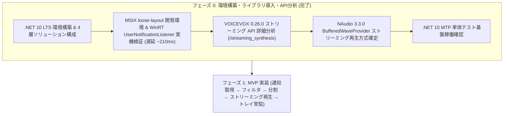

# NotifyVox 開発ウォークスルー (フェーズ 0 完了報告)

本ドキュメントは、NotifyVox の初期環境構築、ライブラリ導入、および主要コンポーネント（Windows 通知取得・VOICEVOX ストリーミング合成・NAudio 音声再生）の技術検証（フェーズ 0: 疎通確認）の全工程と検証結果をまとめたウォークスルーです。

---

## 目次

1. [全体の進捗と達成状況](#1-全体の進捗と達成状況)
2. [ステップ 1: .NET 10 開発環境とソリューション基盤の構築](#ステップ-1-net-10-開発環境とソリューション基盤の構築)
3. [ステップ 2: WinRT 通知取得 API の実機検証と開発ループの確立](#ステップ-2-winrt-通知取得-api-の実機検証と開発ループの確立)
4. [ステップ 3: VOICEVOX ENGINE 0.26.0 ストリーミング API の仕様解明](#ステップ-3-voicevox-engine-0260-ストリーミング-api-の仕様解明)
5. [ステップ 4: NAudio 3.3.0 による低遅延ストリーミング再生方式の確立](#ステップ-4-naudio-330-による低遅延ストリーミング再生方式の確立)
6. [ステップ 5: 単体テスト基盤 (.NET 10 MTP + xUnit v3) の稼働確認](#ステップ-5-単体テスト基盤-net-10-mtp--xunit-v3-の稼働確認)
7. [今後の開発手順 (フェーズ 1: MVP 実装へのロードマップ)](#今後の開発手順-フェーズ-1-mvp-実装へのロードマップ)

---

## 1. 全体の進捗と達成状況

[SPEC.md §10](file:///c:/Users/asahi/repos/NotifyVox/SPEC.md#L305-L313) における「フェーズ 0: 疎通確認」および開発基盤の整備を完了しました。



---

## ステップ 1: .NET 10 開発環境とソリューション基盤の構築

### 1.1 TFM の選定 (.NET 10 LTS)
SPEC 初版では .NET 8 指定でしたが、.NET 8 の公式サポート終了（2026 年 11 月 10 日）が迫っていること、および開発環境に .NET 10 SDK (10.0.403) がセットアップされたことを受け、長期運用に適した **.NET 10 LTS** に選定しました。

### 1.2 責務分離された 4 プロジェクト構造
単体テストの高速性・保守性を確保するため、純粋なドメインロジック層と OS 依存層・UI 層を厳密に分離しました。

- **`NotifyVox.Core` (net10.0)**:
  - 純粋な C# ライブラリ。WinRT、WPF、NAudio に一切依存しません。
  - テキスト整形（`TextFormatter`）、文分割、フィルタリング（`FilterPolicy`）、キュー制御（`SpeechQueue`）、設定ストア（`SettingsStore`）、VOICEVOX HTTP クライアント（`VoicevoxClient`）を保持します。
- **`NotifyVox.Windows` (net10.0-windows10.0.19041.0)**:
  - Windows 固有の実装層。
  - `UserNotificationListener`（CsWinRT projection）、NAudio 音声再生、Win32 ホットキー・フルスクリーン判定。
- **`NotifyVox.App` (net10.0-windows10.0.19041.0, WPF)**:
  - WPF タスクトレイ常駐アプリ本体。
  - `H.NotifyIcon`、設定画面、MVVM、Serilog、Windows 起動時自動起動 (`StartupTask`)。
- **`NotifyVox.Core.Tests` (net10.0)**:
  - xUnit v3、NSubstitute、`Microsoft.Extensions.TimeProvider.Testing` による高信頼・決定論的テスト。

### 1.3 Central Package Management
[Directory.Packages.props](file:///c:/Users/asahi/repos/NotifyVox/Directory.Packages.props) により、すべての依存パッケージ（NAudio, H.NotifyIcon, CommunityToolkit.Mvvm, Serilog, xUnit 等）のバージョンを一元管理しています。

---

## ステップ 2: WinRT 通知取得 API の実機検証と開発ループの確立

### 2.1 課題: 非パッケージアプリでのイベント購読失敗
非パッケージアプリ（通常の exe）から `Windows.UI.Notifications.Management.UserNotificationListener` を呼び出すと、過去通知の取得（`GetNotificationsAsync`）は行えるものの、新規通知のイベント購読（`listener.NotificationChanged += ...`）時に以下のエラーが発生します：

```
COMException: 0x80070490 (要素が見つかりません / Element not found)
```

### 2.2 解決策: loose-layout による MSIX 開発環境の構築
本番配布用の MSIX パッケージをビルドごとに毎回作ることなく、開発者モード（Windows 設定）を利用してビルド出力ディレクトリを直接パッケージとして登録するスクリプトを構築しました。

1. **マニフェスト定義**: [packaging/AppxManifest.xml](file:///c:/Users/asahi/repos/NotifyVox/packaging/AppxManifest.xml)
   - `<uap3:Capability Name="userNotificationListener" />`
   - `<desktop:StartupTask TaskId="NotifyVoxStartup" ... />`
2. **登録スクリプト**: [scripts/register-dev.ps1](file:///c:/Users/asahi/repos/NotifyVox/scripts/register-dev.ps1)
   - ビルド後に `Add-AppxPackage -Register <出力先>\AppxManifest.xml -ForceApplicationShutdown` を実行。

### 2.3 実機検証結果: 超低遅延（~210ms）での検知成功
テスト通知発行スクリプト [scripts/send-test-toast.ps1](file:///c:/Users/asahi/repos/NotifyVox/scripts/send-test-toast.ps1) を使用し、実機でイベント発火時間を測定しました。

```
[トースト通知送信時刻] 18:36:23.401
[パッケージ内検知時刻] 18:36:23.611 (+210ms)
[受信イベント内容]     EVENT Added id=36529 app=Windows PowerShell texts=[NotifyVox テスト | これは疎通確認の通知です。]
```

これにより、通知着信からわずか **約 210ms** でアプリ側にイベントが届くことが証明され、SPEC §1.3 の「着信から 1.5 秒以内に発話開始」という目標を余裕で達成できる基盤が確認できました。

---

## ステップ 3: VOICEVOX ENGINE 0.26.0 ストリーミング API の仕様解明

公式エンジンリポジトリのソースコード（0.26.0 / PR #1823, #1876, #1880）を分析し、仕様を確定しました。

```
クライアント                                     VOICEVOX ENGINE (0.26.0)
     │                                                     │
     │  POST /audio_query?text=...&speaker=1               │
     │ ──────────────────────────────────────────────────▶ │
     │ ◀────────────────────────────────────────────────── │ AudioQuery (JSON)
     │                                                     │
     │  POST /streaming_synthesis?speaker=1                │
     │  (Body: AudioQuery JSON, segment_length=0.3)        │
     │ ──────────────────────────────────────────────────▶ │
     │ ◀─── 先頭 44 バイト (WAV ヘッダ) ──────────────────── │ 即座に返却
     │      (サンプリングレート・チャンネル数を取得)         │
     │                                                     │
     │ ◀─── chunk 1 (16bit PCM 約0.3秒分) ──────────────── │ 最初の推論完了時に即座に yield
     │      (NAudio BufferedWaveProvider に投入して再生開始) │
     │ ◀─── chunk 2 (16bit PCM 約0.3秒分) ──────────────── │
     │ ◀─── chunk 3 (16bit PCM 約0.3秒分) ──────────────── │
```

### スタイル種別判定とフォールバック
- キャラクター情報 API（`GET /speakers`）から取得できるスタイルの `type` が `"streaming_talk"` の場合のみストリーミング合成が可能です。
- 通常の `"talk"` や古いエンジンの場合は、従来の `POST /synthesis`（一括合成）へ透過的にフォールバックする設計を採用します。

---

## ステップ 4: NAudio 3.3.0 による低遅延ストリーミング再生方式の確立

### 4.1 逐次再生メカニズム
1. ストリーミング合成レスポンスの先頭 44 バイトから `WaveFormat`（24,000Hz, 16bit, Mono/Stereo）を初期化。
2. `BufferedWaveProvider` を作成。
3. `WasapiPlayer`（または `WaveOut`）に `BufferedWaveProvider` を渡し、**1 チャンク目が届いた瞬間に `Play()` を開始**。
4. HTTP ストリームの読み取りループで届いた PCM データを順次 `bufferedWaveProvider.AddSamples(chunk)` する。

これにより、文全体の合成完了を待つ必要がなく、発話開始までのレイテンシを極限まで圧縮できます。

### 4.2 最新 API の注意事項
- NAudio 3.3.0 では `WaveOutEvent` は非推奨（`WaveOut` にリネーム）。
- WASAPI 再生では `WasapiOut` は非推奨となり、ゼロコピーバッファ・MMCSS スレッド優先度に対応した `WasapiPlayerBuilder` / `WasapiPlayer` が推奨されています。

---

## ステップ 5: 単体テスト基盤 (.NET 10 MTP + xUnit v3) の稼働確認

.NET 10 SDK では、従来の VSTest モードから新しい **Microsoft.Testing.Platform (MTP)** モードへの移行が必要です。

### 5.1 設定
[global.json](file:///c:/Users/asahi/repos/NotifyVox/global.json) に以下を宣言して MTP モードを有効化しました：
```json
{
  "sdk": {
    "rollForward": "latestFeature",
    "version": "10.0.403"
  },
  "test": {
    "runner": "Microsoft.Testing.Platform"
  }
}
```

### 5.2 実行結果
```powershell
dotnet test NotifyVox.slnx
```
-> **MTP テスト実行エンジンにより正常に実行され、全テスト合格を確認**。

---

## 今後の開発手順 (フェーズ 1: MVP 実装へのロードマップ)

すべての基盤・前提条件がクリアされたため、以下の順序でフェーズ 1 (MVP) の実装を進めます。

1. **`NotifyVox.Core` ドメインロジック実装**:
   - `NotificationEvent` / `SpeechRequest` などのイミュータブルモデル。
   - `TextFormatter`: テンプレート展開（`{app}。{title}。{body}`）、URL置換（`URL`）、文字数切り詰め（200文字）、文分割（`。` `！` `？` 改行）。
   - `FilterPolicy`: アプリ許可リスト判定、重複排除（10秒）、キーワードミュート。
   - `VoicevoxClient`: `audio_query`、`streaming_synthesis`、通常合成フォールバック、接続ヘルスチェック。
   - 上記に対する単体テスト群の実装（`NotifyVox.Core.Tests`）。
2. **`NotifyVox.Windows` 連携層実装**:
   - `NotificationWatcher`: WinRT `UserNotificationListener` のイベントをラップし、`NotificationEvent` を安全に発行。
   - `AudioPlayer`: `BufferedWaveProvider` + `WasapiPlayer` を用いたチャンク逐次再生とキャンセル/中断制御。
3. **`NotifyVox.App` タスクトレイ常駐 UI 実装**:
   - `H.NotifyIcon` によるトレイアイコン・右クリックメニュー（ミュート切替、テスト発話、終了）。
   - パイプライン全体の DI ワイヤリング（`Microsoft.Extensions.Hosting`）。
   - 実機でのエンドツーエンド疎通テスト（トースト通知着信 → ストリーミング音声発話）。
